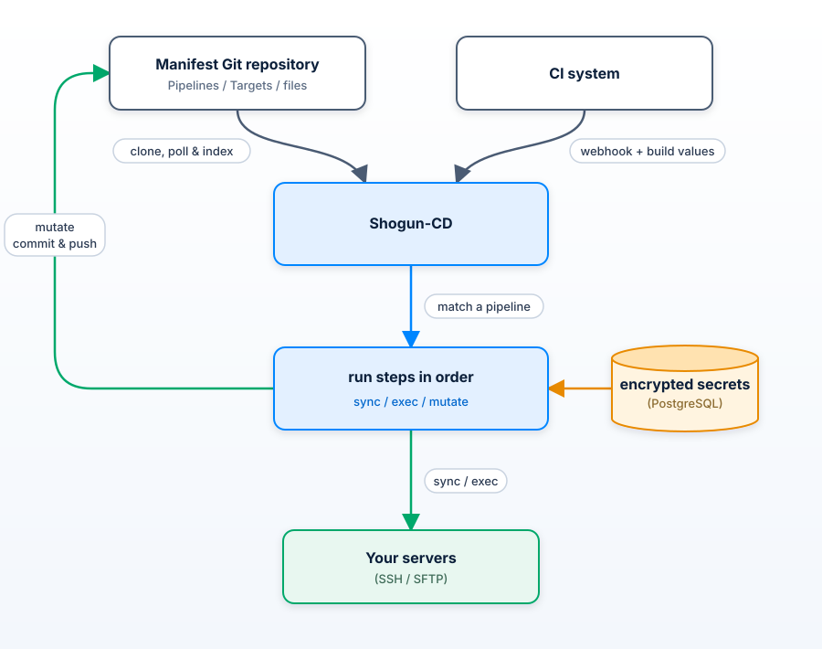

# Shogun-CD


**A simple, self-hosted continuous delivery tool for Git-based deployments.**

Shogun-CD watches a Git repository and deploys changes to your servers via SSH and SFTP. Pipelines and targets are written in YAML, so your delivery setup stays close to the code and manifests it manages.

Shogun helps one Git repository coordinate deployments across many servers.

> **Status:** Active development. SSH and SFTP deployments are ready to use. Kubernetes support is under development.

## What it does

- Watches a Git repository for changes.
- Runs pipelines when matching files present in the repository change.
- Accepts webhooks from CI systems to run pipelines.
- Copies manifests to servers over SFTP.
- Runs commands on servers over SSH.
- Updates YAML files and pushes the change back to repository.
- Stores secrets encrypted in PostgreSQL.
- Keeps a history of pipeline runs.

## How it works



Shogun-CD clones your manifest repository and looks for `Pipeline` and `Target` YAML files to be indexed. When a matching Git change or webhook arrives, it runs the pipeline steps in order.

## Example

This pipeline sends a Compose file to a server and restarts the application when the API changes.

```yaml
apiVersion: shogun.dev/v1
kind: Pipeline
metadata:
  name: deploy-api
  enabled: true
spec:
  triggers:
    - type: git_changes
      paths: ["services/api/**"]
  steps:
    - sync:
        target: prod-api
        files:
          - src: services/api/compose.yaml
            dst: ~/api/docker-compose.yaml
    - exec:
        target: prod-api
        commands:
          - cd ~/api
          - docker compose up -d
```

See [examples](examples/) for pipeline and target definitions.

## Main features

| Feature | Description |
| --- | --- |
| Scheduled pipelines | Configure crons and payloads in the dashboard; all users can view them and admins manage them. |
| Git triggers | Run pipelines only when selected files change. |
| CI webhooks | Starts a deployment from your CI system. |
| Exec commands | Run deployment commands on a server. |
| SFTP sync | Copy modified files to a server safely from the repo. |
| YAML mutation | Update values in YAML manifests, then commit and push it. |
| Secrets | Store SSH keys and other values encrypted at rest which can be accessed in pipelines. |
| Run history | View pipeline runs and step logs through the API. |
| Web UI | View pipelines, targets, and runs, and manage webhooks and secrets. |
| Listing API | List indexed pipelines and targets via `/system/pipelines` and `/system/targets`. |

## Get started

1. Setup docker for postgres container or provide RDS.
2. Copy [sample.config.yaml](sample.config.yaml) to `config.yaml` and update it for your environment.
3. Add `Pipeline` and `Target` files to your Git repository.
4. Start Shogun-CD:

   ```sh
   $ go run ./cmd
   ```

For local development, `make start` starts PostgreSQL container and runs the app with Air.

When API docs are enabled, open `/docs/` in your browser.

## Scheduled pipelines

Add `cron_trigger` to a pipeline's declared triggers before selecting it in the dashboard:

```yaml
spec:
  triggers:
    - type: cron_trigger
```

Open a cron from the Crons tab to view its run history, showing the latest 10 occurrences with newer/older page controls. Admins can create schedules on a dedicated dashboard page, edit a cron’s Settings, and pause, resume, or delete schedules. Runtime payloads use name/value rows, matching the Run pipeline form. All authenticated users can view schedules and run history. Saved payload values are visible only to admins. A cron references an indexed pipeline and supplies a JSON object of string values, available to steps through `{{KEY}}`. Steps can use `trigger_when: [cron_trigger]`.

Payload values may reference Shogun secrets, for example `{"TOKEN":"{{DEPLOY_TOKEN}}","AUTH":"Bearer {{API_TOKEN}}"}`. Shogun resolves references using the current secret values before each start attempt. Configuration and cron history keep the references rather than decrypted values. If a secret cannot be resolved, the occurrence is recorded as failed without starting the pipeline or retrying.

Set `timezone: UTC` (or another IANA timezone such as `Asia/Kolkata`) in Shogun's configuration. The default is UTC. The Cron page displays this shared timezone; schedules cannot override it. Expressions use five fields: minute, hour, day of month, month, day of week. For example, `0 2 * * *` runs daily at 02:00 in Shogun's timezone. Calendar schedules follow that timezone's daylight saving transitions.

Each observed occurrence gets one persisted start attempt. Disabled or missing pipelines, missing `cron_trigger`, and other start failures are saved in cron history without retries. Successful starts link to pipeline run details and logs, with a link back to the Cron page. Overlapping runs execute concurrently. After downtime Shogun schedules only future occurrences, with no backfill or missed-run records. Attempts interrupted during startup dispatch are marked interrupted on the next restart and left alone. Deleting a schedule retains its history in the Deleted crons view. Admins can open a deleted cron and permanently delete it and its cron run records from its page; linked pipeline runs remain in pipeline history.

## Roadmap forward 

- Kubernetes deployments with `apply`
- CLI for shogun
- API keys
- Live pipeline logs

## License

Licensed under [Apache License 2.0](LICENSE). See [NOTICE](NOTICE).

Created with ❤️ by SDSLabs!

